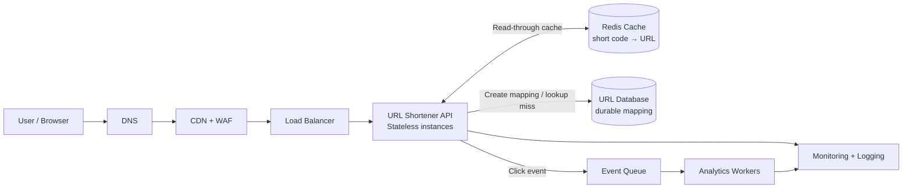

# URL Shortener — High-Level Design

This diagram describes a production-oriented design. The code-generation and
request flows are detailed in the [LLD](LLD.md).

## Responsibilities

- **CDN + WAF:** absorb edge traffic, apply rate limits, and filter abusive
  requests.
- **Stateless API:** validate requests, generate unique short codes, persist
  mappings, and resolve redirects. Multiple instances scale horizontally.
- **Redis:** cache frequently requested codes to reduce database reads.
- **URL database:** persist the canonical `code → destination URL` mapping and
  enforce code uniqueness.
- **Event queue and workers:** process click analytics asynchronously so
  redirect latency does not depend on analytics.
- **Monitoring:** collect request latency, error rates, cache/database health,
  and operational logs.

## Key qualities

- Redirects use a cache-first lookup and fall back to the durable database.
- Mapping writes are committed to the database before a short URL is returned.
- Analytics are eventually consistent; they are not on the redirect critical
  path.
- The database is the source of truth. Cache entries can be rebuilt or expire
  without losing URL mappings.
