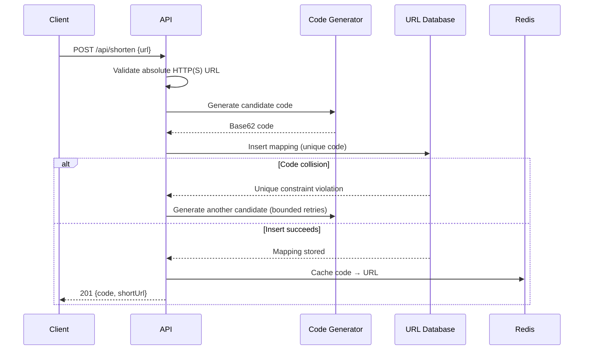
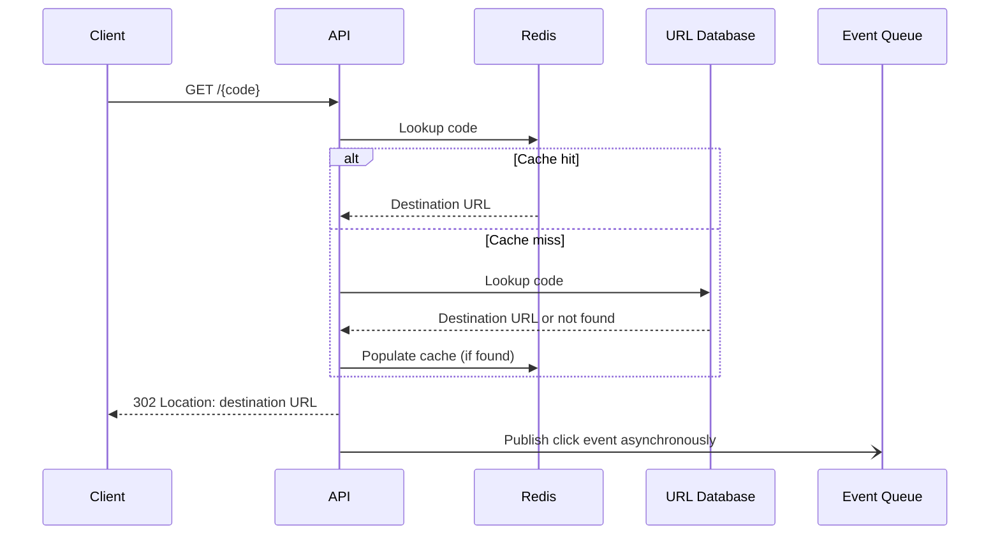

# URL Shortener — Low-Level Design

## Components and request flows

### Create a short URL



### Redirect



## HTTP API

### `POST /api/shorten`

Request:

```json
{
  "url": "https://example.com/articles/design"
}
```

Success (`201 Created`):

```json
{
  "code": "a1B2c3D4",
  "shortUrl": "https://sho.rt/a1B2c3D4"
}
```

Errors: `400` for invalid JSON, a missing URL, or a URL that is not an absolute
HTTP(S) URL; `429` when the client exceeds its rate limit; `500` for unexpected
server errors.

### `GET /{code}`

- `302 Found` with a `Location` header for an existing, active code.
- `404 Not Found` for an unknown or expired code.

## Data model

### `url_mappings`

| Column | Type | Constraints |
| --- | --- | --- |
| `code` | `VARCHAR(16)` | Primary key |
| `destination_url` | `TEXT` | Not null |
| `created_at` | `TIMESTAMP` | Not null |
| `expires_at` | `TIMESTAMP` | Nullable |
| `owner_id` | `UUID` | Nullable |

The primary key provides indexed lookups and prevents duplicate codes. An
optional expiry index supports cleanup of expired links.

### `click_events` (analytics store)

| Column | Type | Constraints |
| --- | --- | --- |
| `event_id` | `UUID` | Primary key |
| `code` | `VARCHAR(16)` | Not null |
| `clicked_at` | `TIMESTAMP` | Not null |
| `referrer` | `TEXT` | Nullable |
| `country` | `CHAR(2)` | Nullable |

Click events are written asynchronously by workers, separate from the mapping
store.

## Short-code generation

Generate a cryptographically random candidate and encode it using Base62
(`0-9`, `a-z`, `A-Z`). Attempt the database insert with its unique constraint;
on collision, generate another candidate and retry a bounded number of times.
Return an explicit server error if all attempts fail. This avoids relying on
probability alone for uniqueness.

## Validation and operational behavior

- Accept only absolute `http` and `https` destination URLs.
- Apply request-body size limits and per-client rate limits to creation.
- Cache successful lookups with a bounded TTL; do not cache missing codes for
  long periods.
- Write the mapping before responding, and populate the cache only after a
  successful database write.
- Keep click-event publishing off the redirect response path.
